# Exercise 4 – UML practice (slide 68)

All diagrams are written in [Mermaid](https://mermaid.js.org/), which GitHub renders directly
in this file. Mermaid has no native *use case* diagram, so those are drawn as flowcharts
(actors = rounded boxes, use cases = ovals, system boundary = subgraph).

- [Exo 1 – Hospital Management System](#exo-1--hospital-management-system)
- [Exo 2 – ABCD Records](#exo-2--abcd-records)

---

# Exo 1 – Hospital Management System

## Task 1 – Basic class diagram (Patient, Doctor, Organizer)

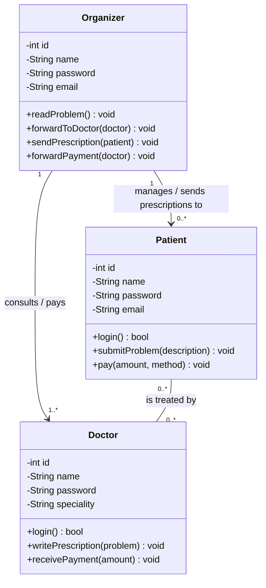

Who interacts with whom: the **Organizer** is the hub between patients and doctors – the
patient never talks to the doctor directly (steps 2, 4 and 6 of the specification).

## Task 2 – Complete class diagram (6 classes + payment types)

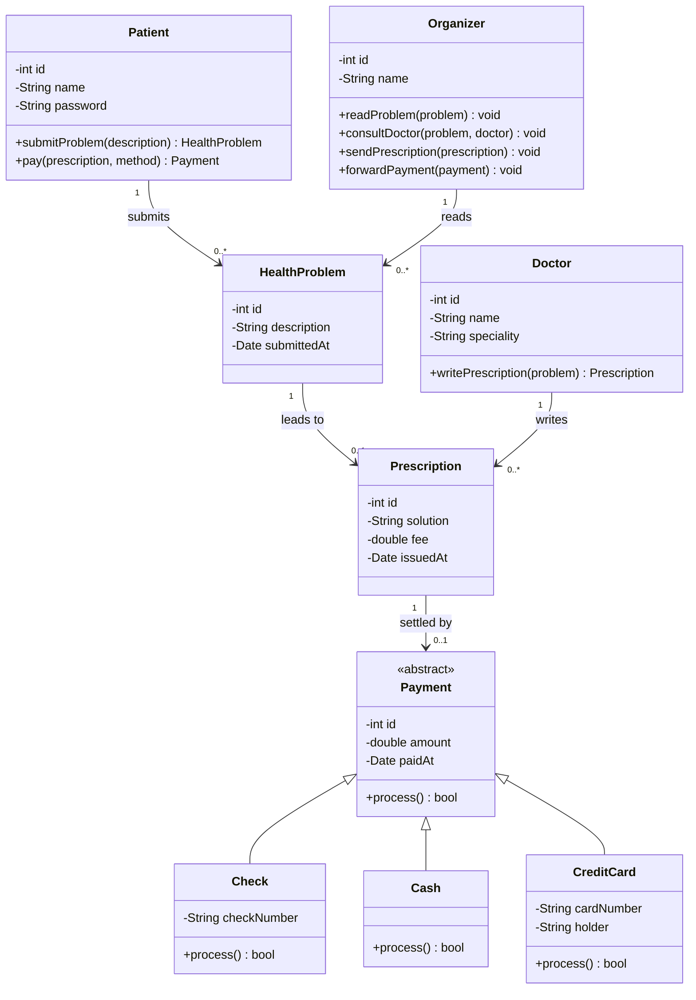

**Sequence diagram – one patient submits a problem, receives a prescription and pays**

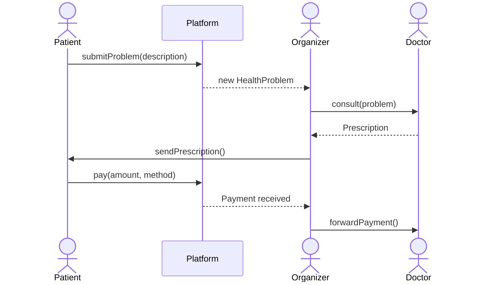

## Task 3 – Advanced model

Additions: `User` superclass, polymorphic payment (Strategy), `HealthProblem` status tracking,
timestamps, and a link to past prescriptions.

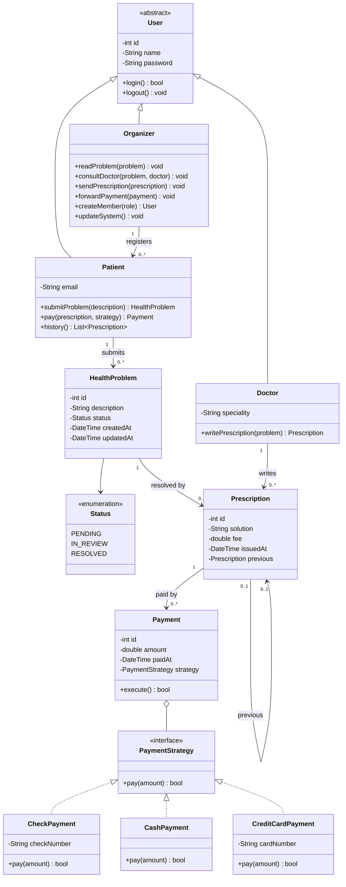

### Sequence 1 – Patient registration

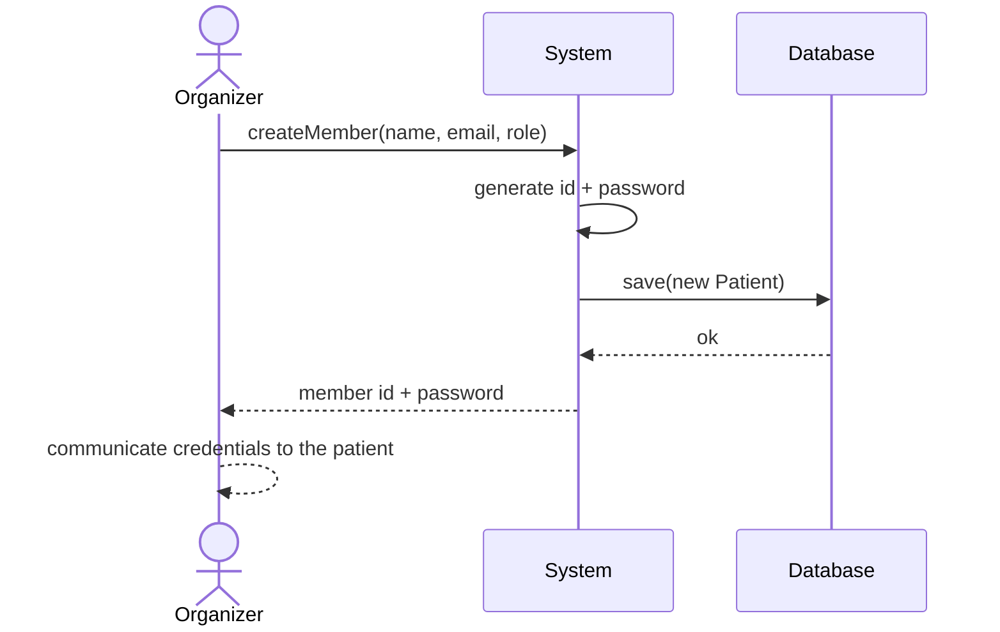

### Sequence 2 – Consultation flow

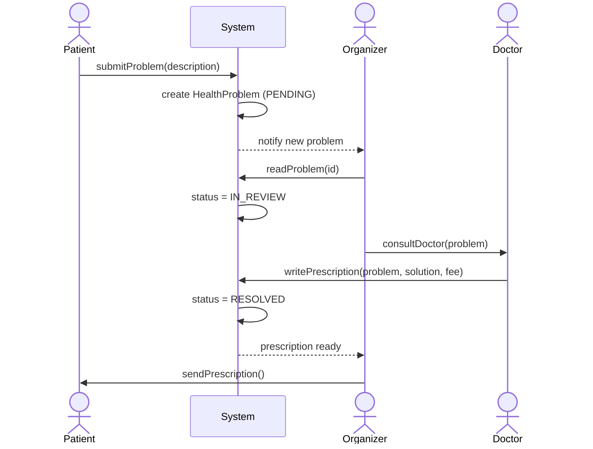

### Sequence 3 – Payment processing

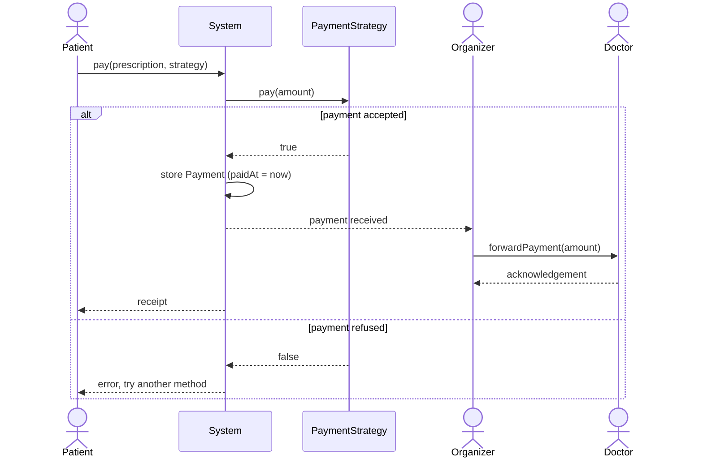

### Questions to consider

1. **A patient consulting several doctors?** Make the problem–doctor link many-to-many through
   `Prescription`: one `HealthProblem` can have several `Prescription`s, each written by a different
   doctor (`Doctor 1 → 0..* Prescription`, `HealthProblem 1 → 0..* Prescription`).
2. **Reusable prescriptions?** Separate the *template* (treatment/solution text) from the *issued
   prescription* (patient, date, fee). The `previous` reference lets a renewal point to the original.
3. **Which design pattern for payments?** **Strategy**: `PaymentStrategy` with `Check`, `Cash`,
   `CreditCard` implementations that can be swapped at runtime (a Factory can build the right one).
4. **Data integrity for payments?** Run payment + status update + forwarding in a single database
   transaction (atomic, all-or-nothing); make the payment request idempotent (unique payment id
   so a retry does not charge twice); validate amount = prescription fee; keep an audit log.

---

# Exo 2 – ABCD Records

## Level 1

### Task 1.1 – Use case diagram

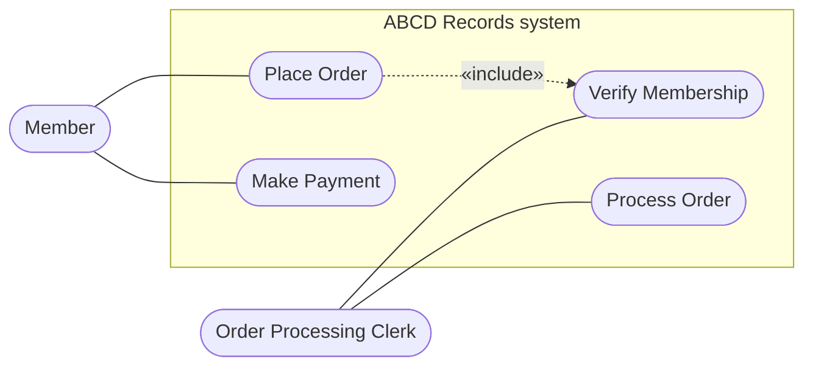

### Task 1.2 – Class diagram

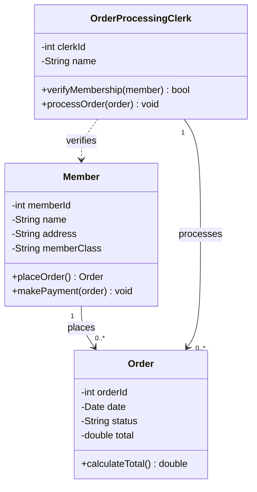

## Level 2

### Task 2.1 – Complete use case diagram

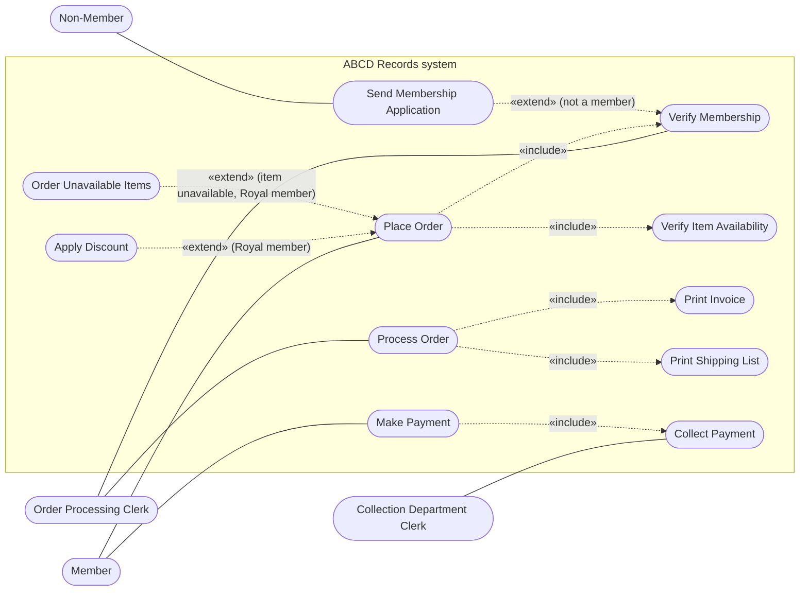

### Task 2.2 – Complete class diagram

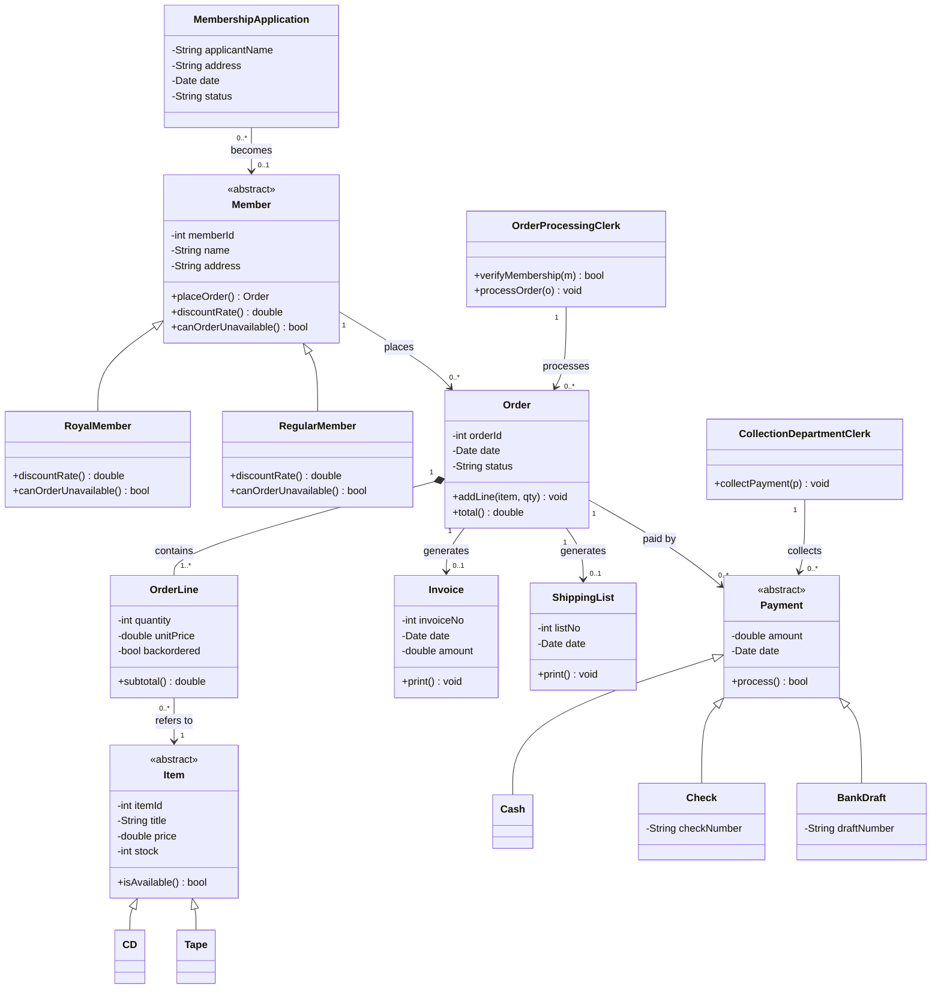

**Scenario – a Royal member orders 2 CDs (one unavailable) and pays by check**

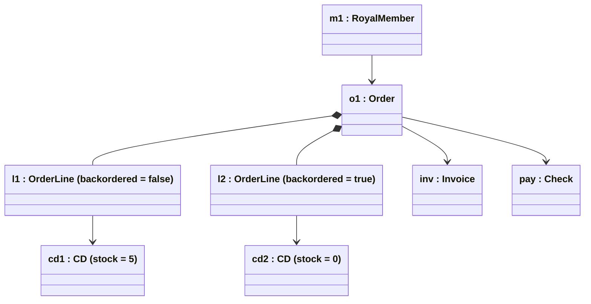

## Level 3 – Sequence diagrams

### 1. Complete order processing flow

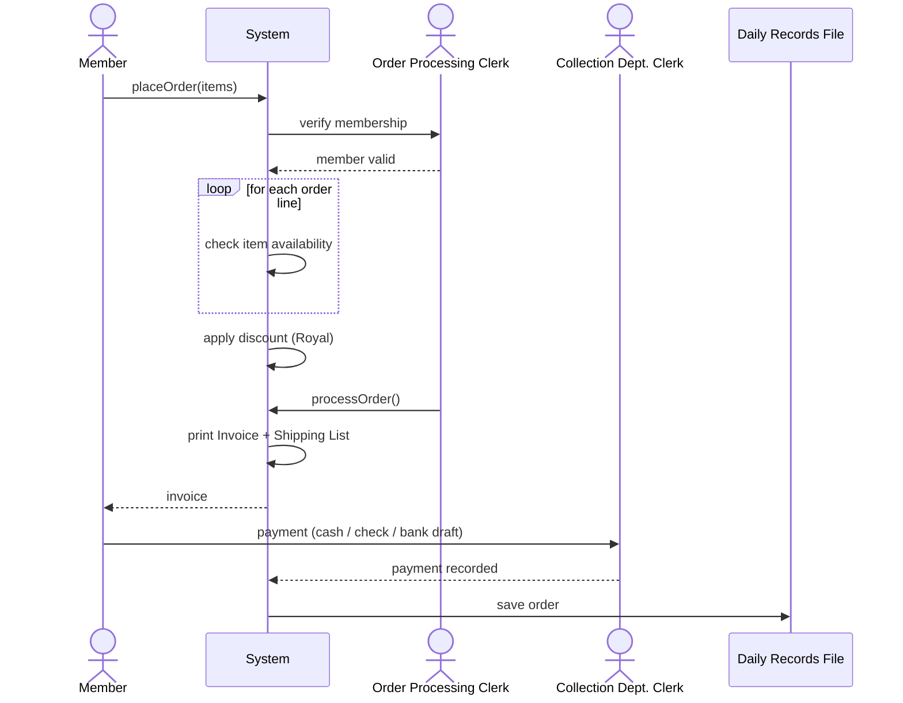

### 2. Membership verification (success and failure)

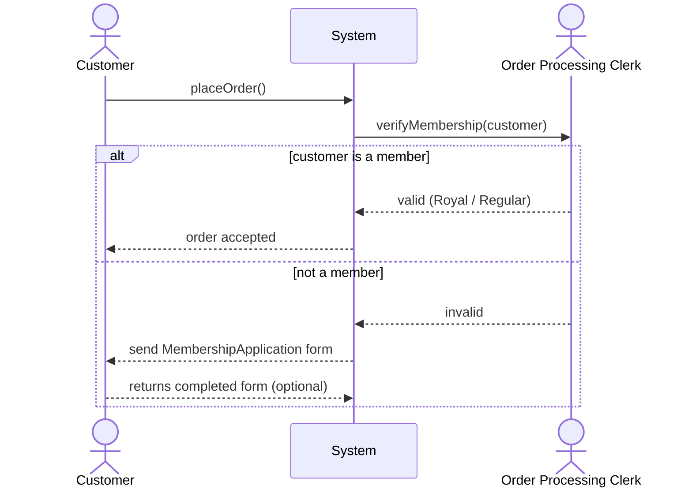

### 3. Payment processing (all types)

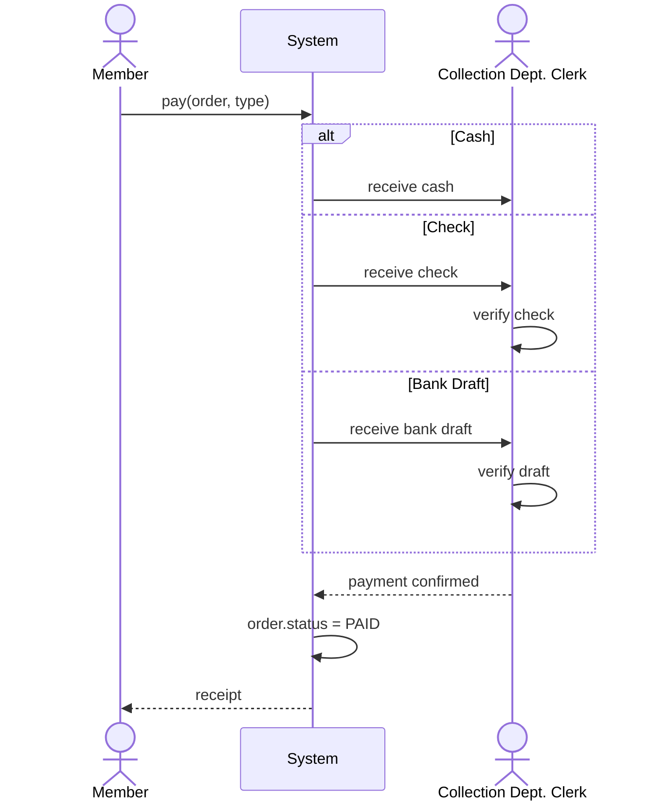

### 4. Item reordering for Royal members

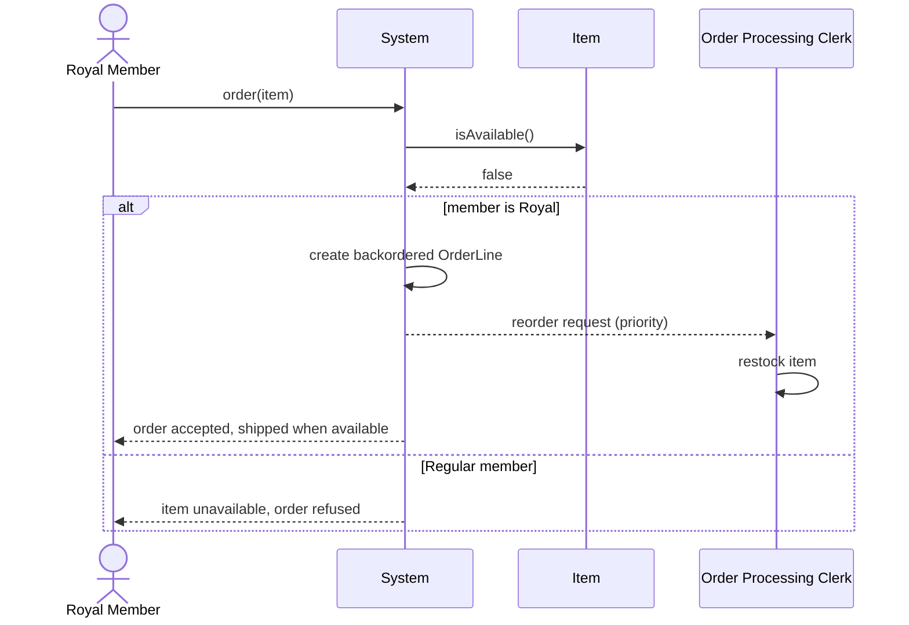
